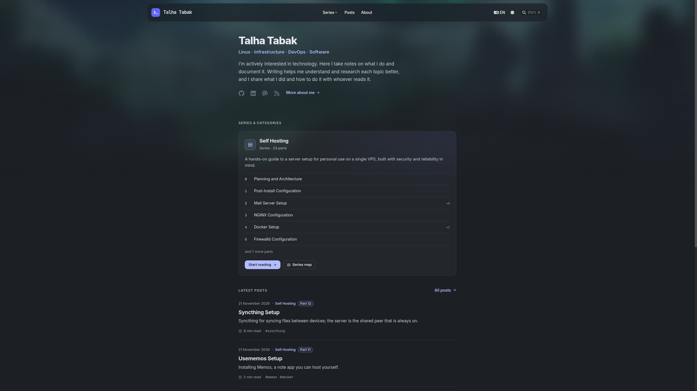
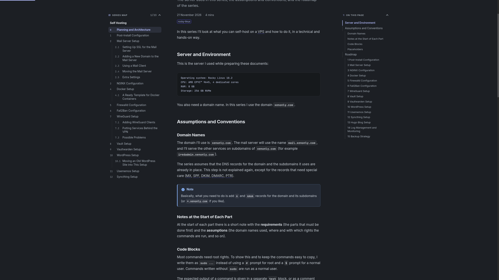

# talhatabak.com

Source of [talhatabak.com](https://talhatabak.com), a bilingual (English / Turkish) blog about Linux, infrastructure, DevOps and software. Built with [Hugo](https://gohugo.io/) and the [Blowfish](https://blowfish.page/) theme.





## Features

- English at `/`, Turkish at `/tr/`; browsers that prefer Turkish are sent to the Turkish page
- Categories with a numbered series map and previous / next links
- Obsidian-compatible Markdown: callouts, single line breaks, code blocks with file names, Mermaid
- Glossary terms explained in a card on hover, and a `/glossary/` page
- Images resized and zoomable; the build stops if a photo still has GPS data
- Light and dark themes, self-hosted fonts, fully static output
- A script that imports Obsidian notes as bilingual posts

## Requirements

- [Hugo](https://gohugo.io/installation/) **extended**, 0.166 or newer
- Git
- Python 3.9+ (only for importing Obsidian notes)

## Installation

```bash
git clone --recurse-submodules https://github.com/atalhatabak/talhatabak.com.git
cd talhatabak.com
hugo server -D        # preview at http://localhost:1313, drafts included
```

Run Hugo from the repository root. Started in a subfolder, it leaves a stray `public/` there that breaks the next build.

## Usage

### Writing a post

```bash
hugo new content --kind post self-hosting/my-new-topic
```

This creates `content/self-hosting/my-new-topic/` with `index.md` (English) and `index.tr.md` (Turkish). The folder name is the URL; the post's images go in the same folder.

```yaml
---
title: "Mail Server Setup"
description: "Shown under the title, in lists and in search results."
date: 2026-02-14
chapter: "2"          # place in the series map; "2.1" is a sub-part of "2"
linkTitle: "Mail"     # optional, a shorter name for the series map
tags: ["mail", "postfix"]
draft: true           # only shown by hugo server -D
---
```

Posts without `chapter` are listed by date under the series map.

### Markdown

| Element | Markdown |
| --- | --- |
| Callout | `> [!note]`, `> [!warning] Custom title` (all GitHub / Obsidian types) |
| Folded callout | `> [!example]-` (closed), `> [!example]+` (open) |
| Code block with a file name | ```` ```nginx {title="/etc/nginx/nginx.conf"} ```` |
| Highlighted lines, line numbers | ```` ```bash {hl_lines=[2,3] linenos=table} ```` |
| Diagram | ```` ```mermaid ```` |
| Image | `` |
| Glossary term | `[SELinux](term:selinux)` |
| Link to a post or heading | `[text](/self-hosting/docker/)`, `[text](/self-hosting/docker/#volumes)` |
| Email address hidden from bots | `` |

Links use content paths; on the Turkish site they open the Turkish page.

**Images:** if a photo still has GPS data, the build stops and prints the command that removes it (`magick photo.jpg -auto-orient -strip photo.jpg`). A `featured.jpg` in the post folder is the preview image when the link is shared.

**Glossary:** terms are defined in `data/glossary.yaml`. The link text can differ from the title, so Turkish suffixes work: `[SELinux'un](term:selinux)`.

```yaml
selinux:
  title: "SELinux"
  en: "A kernel security layer that decides what each process may access."
  tr: "Her sürecin nelere erişebileceğine karar veren bir çekirdek güvenlik katmanı."
  link: "https://en.wikipedia.org/wiki/Security-Enhanced_Linux"   # optional
```

### Importing notes from Obsidian

[`tools/obsidian-import/import_notes.py`](tools/obsidian-import/import_notes.py) turns a folder of Obsidian notes into bilingual posts:

```bash
python3 tools/obsidian-import/import_notes.py path/to/notes
python3 tools/obsidian-import/import_notes.py --help    # how to add a new note
```

- The notes to import and the choices for each note (callout types, code block titles, glossary terms) are listed at the top of the script. A note's file name starts with its chapter number (`2.1 Title.md`).
- For each note it writes `content/self-hosting/<slug>/index.tr.md` from the note (Turkish) and `index.md` from the English text in `tools/obsidian-import/en/<slug>.md`.
- On the way it adds the front matter, turns links between notes into site links, turns `>` notes into callouts, adds file names to code blocks and links the first use of each glossary term.
- Code blocks are written once, in the note; the English text has a `@@code@@` line where each one goes.
- The posts are rewritten on every run, so changes go into the note or the English text, not into `content/`.

### New category

1. Create `content/<category>/_index.md` and `_index.tr.md` (`title`, `description`, `icon`, `weight`).
2. Add the folder name to `mainSections` in `config/_default/params.toml`.
3. Add it to the *Series* menu in `config/_default/menus.en.toml` and `menus.tr.toml` (`parent = "series"`).

## Building

```bash
hugo --gc --minify    # writes the site to public/
```

`public/` contains only static files, so any web server can serve it. Every build empties it first, so files the site needs (for example a verification file) belong in `static/`. The error pages are `/404.html` and, for Turkish pages, `/tr/404.html`.

## Updating the theme

Blowfish is a Git submodule in `themes/blowfish` (v3.10.0). Don't edit it; site changes live in `layouts/`, `assets/` and `config/`.

```bash
cd themes/blowfish
git fetch --depth 1 origin tag v3.11.0
git checkout v3.11.0
cd ../.. && hugo server -D    # check the site, then commit themes/blowfish
```

## Project structure

| Path | Contents |
| --- | --- |
| `content/` | Pages and posts (`<category>/<post>/index.md`, `index.tr.md`) |
| `config/_default/` | Site, theme, language and menu settings |
| `data/glossary.yaml` | Glossary terms |
| `layouts/` | Templates that override the theme: article, series map, Markdown hooks |
| `assets/` | Styles (`css/custom.css`), scripts (`js/blog.js`), icons, images |
| `i18n/` | Interface text in English and Turkish |
| `static/` | Files copied as they are (fonts) |
| `tools/obsidian-import/` | Obsidian import script and the English texts |
| `tools/deploy/`, `.github/workflows/` | How the live site is deployed (specific to its server) |
| `public/` | The built site (not committed) |

## Credits

Built with [Hugo](https://gohugo.io/) and [Blowfish](https://github.com/nunocoracao/blowfish).

Home page background (`assets/img/home-bg/`): "North" by Andrey Koshelev, licensed under [CC BY-SA 4.0](https://creativecommons.org/licenses/by-sa/4.0/). The images here are resized; on the site they are blurred and faded. They remain under CC BY-SA.
